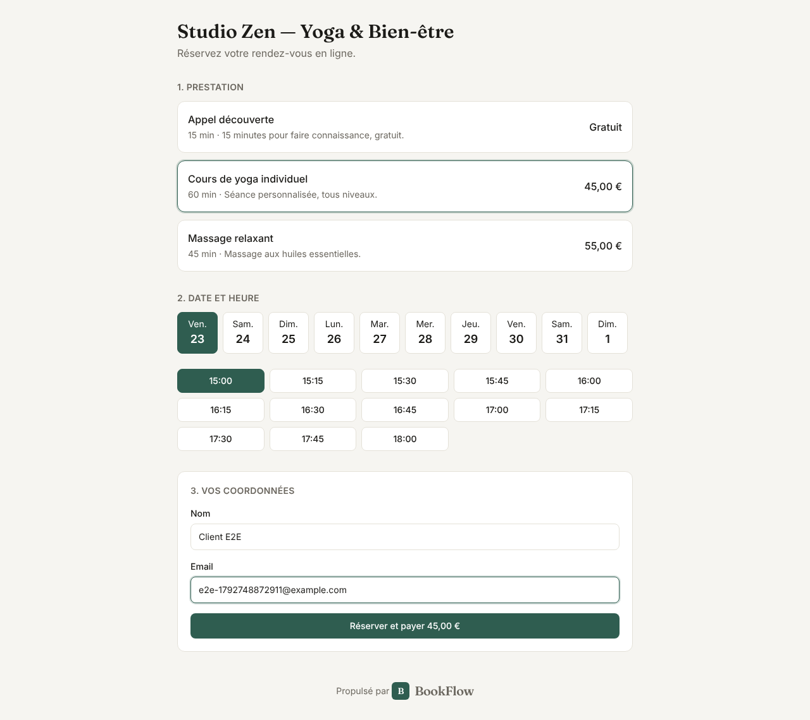
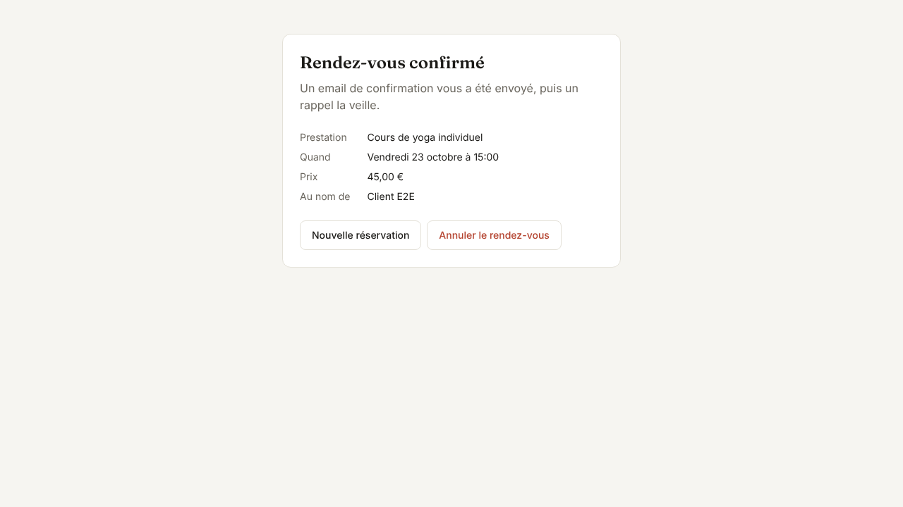
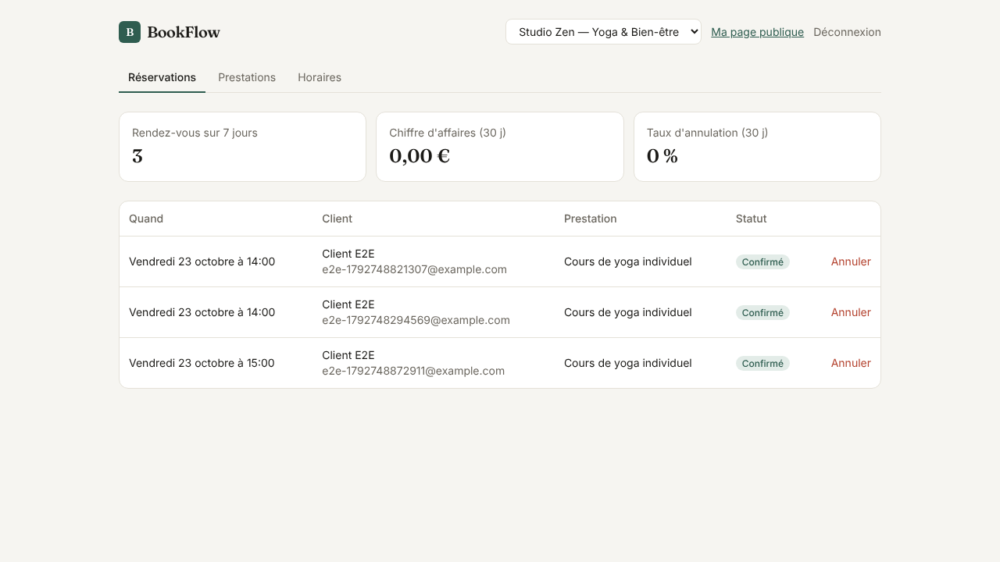

# BookFlow

**Multi-tenant online appointment booking (SaaS): reservations, payments, reminders and a management dashboard.**


A hair salon, yoga studio or medical practice publishes its own `bookflow/<entreprise>` page; customers pick
a service and a time slot, pay online, and receive a confirmation followed by a reminder the day before.
The business owner manages appointments, services, opening hours and staff from a dashboard.

| Booking page | Confirmed appointment |
|---|---|
|  |  |



## What makes this project interesting

A booking app looks simple. The real challenges lie elsewhere, and each one is addressed
and **tested** here:

| Real-world problem | Solution | Evidence |
|---|---|---|
| **Double booking**: two customers click the same slot within the same millisecond | PostgreSQL exclusion constraint `EXCLUDE USING gist (staff_id WITH =, tstzrange(start_at, end_at) WITH &&)`: the guarantee is enforced by the database, not by application code | Load test: 100 concurrent clients on 5 slots → **exactly 5 bookings, 95 clean rejections (409), 0 errors** |
| **Data leaking between tenants** (multi-tenancy) | PostgreSQL **Row-Level Security** (`FORCE`): every transaction carries `app.tenant_id` and the database itself filters every row | Isolation tests; the test suite refuses to run under a superuser role (which would bypass RLS) |
| **Payments**: a slot held by a customer who never pays, a webhook delivered twice | `pending_payment` status expired by the worker after 15 min; Stripe webhook is **signature-verified** and **idempotent** (processed-events table) | Tests: invalid signature rejected, replayed webhook has no effect, expiry |
| **Lost emails** when the SMTP server goes down | **Outbox** pattern: notifications are written in the same transaction as the booking and sent by a worker (`FOR UPDATE SKIP LOCKED`, 5 attempts) | Confirmation and reminder tests |
| **Slowness** of the most-visited page (slot computation) | Per-tenant versioned Redis cache, **zero SQL queries** on a cache hit, invalidation **after commit** | k6: **3.2× throughput**, 3.5× lower p95 |

## Architecture

```
 Browser ─────► Next.js 15 (Vercel) ──► FastAPI API ──► PostgreSQL 16 (RLS + exclusion constraint)
                                             │   └────► Redis (slot cache, rate limiting)
 Stripe ──── signed webhook ────────────────►┘
                                     Worker ──► expires pending payments, sends confirmations and reminders (outbox)
```

| Layer | Technologies |
|---|---|
| Backend | Python 3.12, **FastAPI**, SQLAlchemy 2, Alembic, Pydantic v2 |
| Data | **PostgreSQL 16** (RLS, `btree_gist`, `tstzrange`), **Redis 7** |
| Auth | JWT, Argon2 password hashing, **Google sign-in** (token verified against Google's public keys); owner / admin / staff roles |
| Payments | **Stripe Checkout** (test mode); mock provider for the demo and CI |
| Frontend | **Next.js 15** (App Router), React 19, TypeScript, Tailwind CSS v4 |
| Quality | **pytest** (37 tests, **95% coverage**, real PostgreSQL database), **Playwright** (end-to-end flows), **k6** (load), Ruff, ESLint |
| Ops | Docker, docker compose, GitHub Actions, Render (API + worker + Postgres + Redis) and Vercel, **Prometheus** metrics (`/metrics`), `X-Request-ID` request IDs |

## Performance measurements (k6)

Measured locally on a shared **2 vCPU** machine (API: 2 uvicorn workers, PostgreSQL and Redis
on the same machine): the absolute numbers are modest; what matters is the **relative difference**.

**Slot reads** (`loadtest/slots.js`, 50 virtual users, 30 s):

| | Throughput | p95 latency | Failures |
|---|---|---|---|
| No cache | 209.5 req/s | 381.6 ms | 0% |
| **With Redis cache** | **670.8 req/s** | **107.8 ms** | **0%** (20,190 requests) |

**Slot race** (`loadtest/booking.js`, 100 clients fired simultaneously at 5 slots):
5 bookings created, 95 conflicts returned as `409`, 0 errors, p95 789 ms; in the database, 5 appointments
across 5 distinct time slots.

## Two bugs caught by load testing

**1. A deadlock invisible to unit tests.** On the first load test, 40% of concurrent
bookings hung for 30 s. Root cause: the SQL session was a FastAPI `yield` dependency, whose commit runs
during teardown, **in a thread-pool thread**. Once every thread was waiting on a row lock held by an
uncommitted transaction, no thread was left to commit it. Fix: the write transaction is opened **and
committed** within the request handler itself (`deps.public_tx`), with `SET LOCAL lock_timeout` as a
safeguard (→ `409`). Result: 0 errors.

**2. A stale-data window in the cache.** The cache was invalidated *before* the commit, so a
concurrent read could recompute the slots from the old state and write it back to the cache.
Invalidation now hooks into the SQLAlchemy `after_commit` event (and is discarded on
`after_rollback`).

## Running locally

```bash
docker compose up --build
```

- Frontend: http://localhost:3000 — public demo page: http://localhost:3000/studio-zen
- API and OpenAPI docs: http://localhost:8000/docs
- Demo account: `demo@bookflow.dev` / `demo1234` (or the « Tester le tableau de bord » ("Try the dashboard") button on the home page)

Payments are mocked by default. To use Stripe in test mode:
`PAYMENTS_PROVIDER=stripe STRIPE_SECRET_KEY=sk_test_… STRIPE_WEBHOOK_SECRET=whsec_… docker compose up`,
then `stripe listen --forward-to localhost:8000/webhooks/stripe`.

### Without Docker

```bash
# With PostgreSQL 16 + Redis 7 running:
psql -U postgres -f deploy/init-db.sql          # NON-superuser application role
cd backend && pip install -r requirements-dev.txt
alembic upgrade head && python -m app.seed
uvicorn app.main:app --reload                    # API
python -m app.worker                             # worker (separate terminal)
pytest --cov=app                                 # tests
cd ../frontend && npm ci && npm run dev          # frontend
npx playwright test                              # end-to-end (API must be running)
k6 run ../loadtest/slots.js                      # load test
```

## API

| Public (no account) | Admin (JWT + `X-Tenant` header) |
|---|---|
| `GET /public/{slug}` — business and services | `GET/POST/PATCH/DELETE /admin/services` |
| `GET /public/{slug}/slots?service_id&date` | `GET /admin/bookings` (cursor pagination) |
| `POST /public/{slug}/bookings` (limited to 10/min/IP) | `POST /admin/bookings/{id}/cancel` |
| `GET /public/{slug}/bookings/{id}?token` | `GET/PUT /admin/availability` |
| `POST /public/{slug}/bookings/{id}/cancel?token` | `GET/POST /admin/staff` · `GET /admin/stats` |
| `POST /auth/register` · `/auth/login` · `/auth/google` · `GET /me` | `POST /webhooks/stripe` · `GET /health` · `GET /metrics` |

Staff members only see their own appointments; only owners and admins can manage services and staff.

## Deployment

- **Render**: `render.yaml` defines the API, worker, PostgreSQL and Redis (Blueprint).
- **Vercel**: root directory `frontend/`, environment variable `NEXT_PUBLIC_API_URL`.
- CI triggers both deployments once tests pass, provided the `RENDER_DEPLOY_HOOK_URL`
  and `VERCEL_DEPLOY_HOOK_URL` secrets are set.

## Project structure

```
backend/app/
  scheduling.py   slot computation, concurrent booking, cancellation, notifications
  db.py           tenant-scoped sessions (RLS), post-commit cache invalidation
  cache.py        versioned Redis cache, rate limiting (sliding window)
  payments.py     Stripe Checkout / mock provider
  worker.py       payment expiry, notification delivery (outbox)
  routers/        auth, public, admin, payments
backend/migrations/  schema, exclusion constraint, RLS policies
backend/tests/       37 tests against real PostgreSQL and Redis
frontend/src/app/    public page, booking tracking, sign-in, dashboard
frontend/e2e/        Playwright
loadtest/            k6 scenarios
```

## License

MIT — Mohamed Anas Ben Mim
